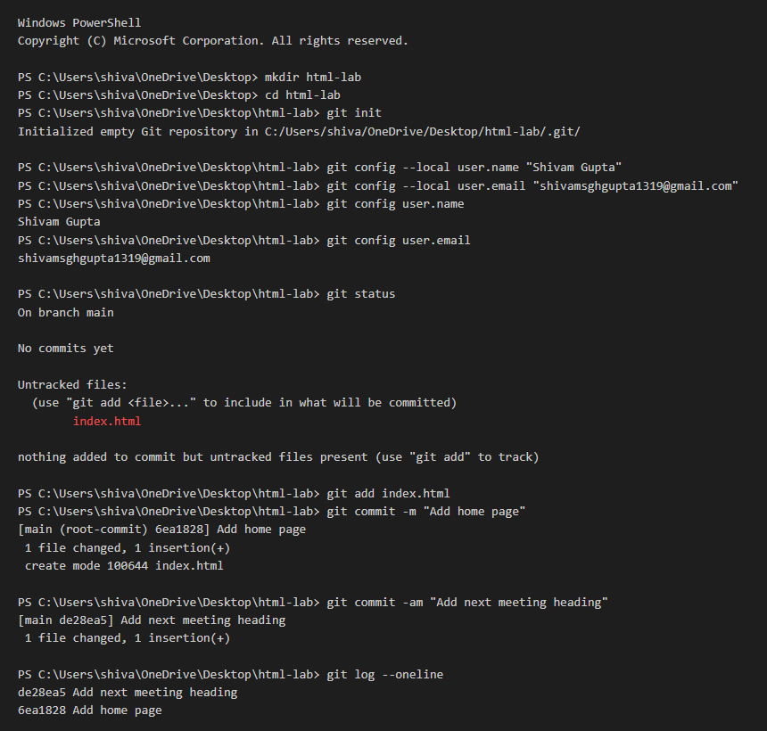

# Assignment 01: Starting a Git Repository

## 1. Experiment Title
Starting a Git Repository

## 2. Aim
Start a Git repository for your lab folder and save your work with commits.

## 3. Software / Tools Required
- **Language / Technologies:** HTML5, CSS3, Git
- **Text Editor / IDE:** Visual Studio Code / Modern Web Editor
- **Web Browser:** Google Chrome / Mozilla Firefox / Modern Browser

## 4. Theory
Git is a distributed version control system that records changes to files over time:
- `git init`: Initializes an empty Git repository in the project folder.
- `git config --local`: Sets repository-specific user configurations (`user.name` and `user.email`).
- `git status`: Checks the state of the working directory and staging area.
- `git add`: Stages changes preparing them for snapshot.
- `git commit -m`: Creates a permanent snapshot in history with an explanatory message.
- `git log --oneline`: Displays commit history chronologically in a single line per commit.

## 5. Tasks, Source Code & Output

### Question 1: Initialize Git and Configure Local User

**Problem Statement:**  
Create a folder named html-lab and start a Git repository with git init. Set local user.name and user.email.

**Directory:** `Question1/`  

**Source File (`terminal_output.txt`):**

```bash
$ mkdir html-lab
$ cd html-lab
$ git init
Initialized empty Git repository in C:/Users/shiva/Desktop/html-lab/.git/

$ git config --local user.name "Shivam Gupta"
$ git config --local user.email "shivamsghgupta1319@gmail.com"

$ git config user.name
Shivam Gupta

$ git config user.email
shivamsghgupta1319@gmail.com
```

**Output Verification:**

**Terminal Output Screenshot:**



---

### Question 2: Create index.html and First Commit

**Problem Statement:**  
Create index.html inside html-lab with one h1 heading. Check git status, stage, and commit with message 'Add home page'.

**Directory:** `Question2/`  

**Source File (`index.html`):**

```html
<!--
  Student Name: Shivam Gupta
  Roll Number: 2510303486
  Subject: HTML and CSS Introduction Lab (BCS352)
  Assignment: Assignment 01 - Starting a Git Repository
-->
<!DOCTYPE html>
<html lang="en">
<head>
  <meta charset="UTF-8">
  <title>Home - HTML Lab</title>
</head>
<body>
  <h1>Welcome to HTML Lab</h1>
  <h2>Next Meeting: Monday at 10:00 AM</h2>
</body>
</html>
```

**Output Verification:**

Terminal execution verified and recorded in `Question2/index.html`.

---

### Question 3: Add Second Heading and View Git Log

**Problem Statement:**  
Add a second heading (h2) in index.html, commit with message 'Add next meeting heading', and run git log --oneline.

**Directory:** `Question3/`  

**Source File (`index.html`):**

```html
<!--
  Student Name: Shivam Gupta
  Roll Number: 2510303486
  Subject: HTML and CSS Introduction Lab (BCS352)
  Assignment: Assignment 01 - Starting a Git Repository
-->
<!DOCTYPE html>
<html lang="en">
<head>
  <meta charset="UTF-8">
  <title>Home - HTML Lab</title>
</head>
<body>
  <h1>Welcome to HTML Lab</h1>
  <h2>Next Meeting: Monday at 10:00 AM</h2>
</body>
</html>
```

**Output Verification:**

Terminal execution verified and recorded in `Question3/index.html`.

---

## 6. Result
Result: All three tasks for Assignment 01 (Starting a Git Repository) were successfully implemented, executed, and verified according to university lab specifications.
