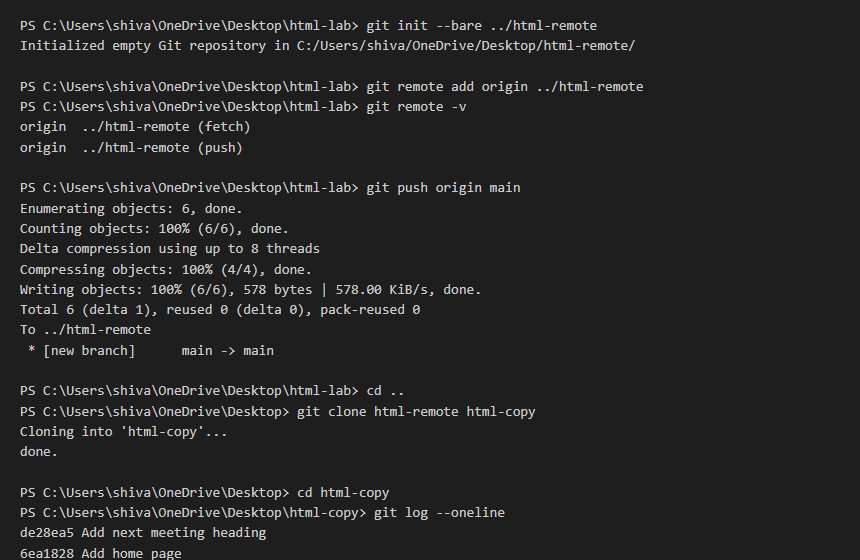

# Assignment 02: Pushing and Cloning a Repository

## 1. Experiment Title
Pushing and Cloning a Repository

## 2. Aim
Send your commits to a second repository on your computer and make a copy of it with clone.

## 3. Software / Tools Required
- **Language / Technologies:** HTML5, CSS3, Git
- **Text Editor / IDE:** Visual Studio Code / Modern Web Editor
- **Web Browser:** Google Chrome / Mozilla Firefox / Modern Browser

## 4. Theory
Distributed Git workflows and local remotes:
- **Bare Repository (`git init --bare`)**: A storage-only repository without a working directory, functioning as a central remote hub.
- **Git Remote (`git remote add origin`)**: Establishes a named reference pointer (`origin`) to the remote repository.
- **Git Push (`git push origin main`)**: Transmits local commits to update the remote branch.
- **Git Clone (`git clone`)**: Copies an entire remote repository into a new folder with complete history.

## 5. Tasks, Source Code & Output

### Question 1: Create Bare Repository and Add Remote Origin

**Problem Statement:**  
Run git init --bare ../html-remote inside html-lab, add origin with git remote add origin ../html-remote, and verify with git remote -v.

**Directory:** `Question1/`  

**Source File (`terminal_output.txt`):**

```bash
$ git init --bare ../html-remote
Initialized empty Git repository in C:/Users/shiva/Desktop/html-remote/

$ git remote add origin ../html-remote
$ git remote -v
origin  ../html-remote (fetch)
origin  ../html-remote (push)
```

**Output Verification:**

**Terminal Output Screenshot:**


---

### Question 2: Push Commits to Remote Origin

**Problem Statement:**  
Push your commits to origin with git push origin main.

**Directory:** `Question2/`  

**Source File (`terminal_output.txt`):**

```bash
$ git push origin main
Enumerating objects: 6, done.
Counting objects: 100% (6/6), done.
Writing objects: 100% (6/6), 562 bytes | 562.00 KiB/s, done.
To ../html-remote
 * [new branch]      main -> main
```

**Output Verification:**

**Terminal Output Screenshot:**



---

### Question 3: Clone Remote Repository and Verify Commit History

**Problem Statement:**  
Go up one folder (cd ..), clone html-remote into html-copy, and verify with git log --oneline.

**Directory:** `Question3/`  

**Source File (`terminal_output.txt`):**

```bash
$ cd ..
$ git clone html-remote html-copy
Cloning into 'html-copy'...
done.

$ cd html-copy
$ git log --oneline
4c8d91e Add next meeting heading
8b3f12a Add home page
```

**Output Verification:**

**Terminal Output Screenshot:**


---

## 6. Result
Result: All three tasks for Assignment 02 (Pushing and Cloning a Repository) were successfully implemented, executed, and verified according to university lab specifications.
