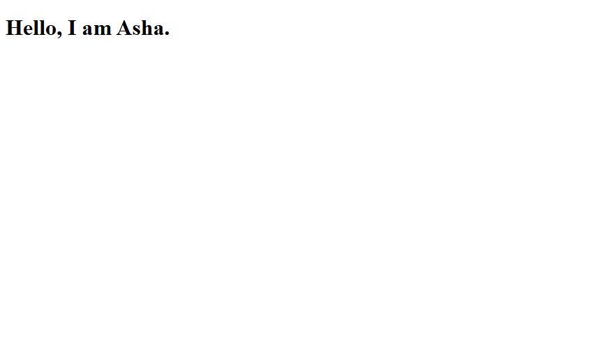
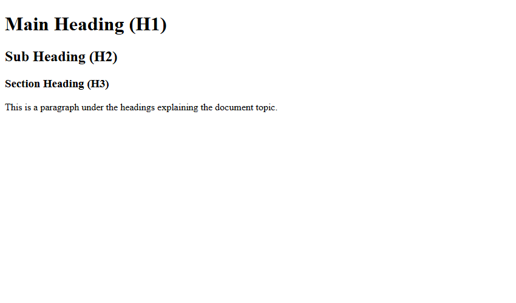
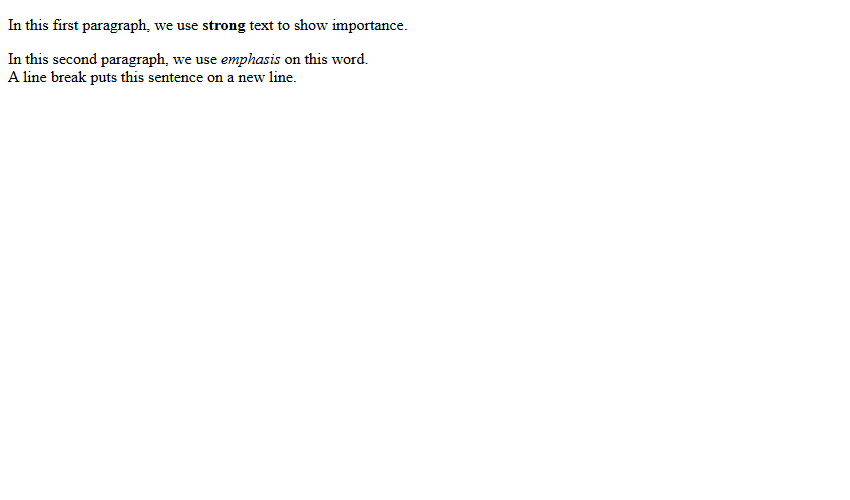

# Assignment 03: Your First HTML Page

## 1. Experiment Title
Your First HTML Page

## 2. Aim
Write a first HTML page with a title, headings and a paragraph, and format some text.

## 3. Software / Tools Required
- **Language / Technologies:** HTML5, CSS3, Git
- **Text Editor / IDE:** Visual Studio Code / Modern Web Editor
- **Web Browser:** Google Chrome / Mozilla Firefox / Modern Browser

## 4. Theory
HTML document structure and basic typographic tags:
- `<!DOCTYPE html>`: Informs the browser that this is an HTML5 document.
- `<html>`, `<head>`, `<body>`: Root elements establishing metadata and visible content.
- Heading tags `<h1>` through `<h6>`: Structural levels defining topic hierarchy.
- Text formatting: `<strong>` (bold semantic emphasis), `<em>` (italic stress), and `<br>` (line break).

## 5. Tasks, Source Code & Output

### Question 1: Document Structure and Page Title

**Problem Statement:**  
Create first.html with standard HTML5 boilerplate, title 'My First Page', and h1 heading 'Hello, I am Asha.'

**Directory:** `Question1/`  

**Source File (`first.html`):**

```html
<!--
  Student Name: Shivam Gupta
  Roll Number: 2510303486
  Assignment: 03 - Task 01 (My First Page)
-->
<!DOCTYPE html>
<html lang="en">
<head>
  <meta charset="UTF-8">
  <title>My First Page</title>
</head>
<body>
  <h1>Hello, I am Asha.</h1>
</body>
</html>
```

**Output Screenshot:**



---

### Question 2: Heading Hierarchy (H1, H2, H3) and Paragraph

**Problem Statement:**  
Create headings.html demonstrating H1, H2, and H3 nested sections with descriptive paragraphs.

**Directory:** `Question2/`  

**Source File (`headings.html`):**

```html
<!--
  Student Name: Shivam Gupta
  Roll Number: 2510303486
  Assignment: 03 - Task 02 (Headings and Paragraph)
-->
<!DOCTYPE html>
<html lang="en">
<head>
  <meta charset="UTF-8">
  <title>Headings</title>
</head>
<body>
  <h1>Main Heading (H1)</h1>
  <h2>Sub Heading (H2)</h2>
  <h3>Section Heading (H3)</h3>
  <p>This is a paragraph under the headings explaining the document topic.</p>
</body>
</html>
```

**Output Screenshot:**



---

### Question 3: Text Formatting with Strong, Em, and Break

**Problem Statement:**  
Create text-format.html using strong for emphasis, em for stress, and br for address line breaks.

**Directory:** `Question3/`  

**Source File (`text-format.html`):**

```html
<!--
  Student Name: Shivam Gupta
  Roll Number: 2510303486
  Assignment: 03 - Task 03 (Text Formatting)
-->
<!DOCTYPE html>
<html lang="en">
<head>
  <meta charset="UTF-8">
  <title>Text Formatting</title>
</head>
<body>
  <p>In this first paragraph, we use <strong>strong</strong> text to show importance.</p>
  <p>In this second paragraph, we use <em>emphasis</em> on this word.<br>A line break puts this sentence on a new line.</p>
</body>
</html>
```

**Output Screenshot:**



---

## 6. Result
Result: All three tasks for Assignment 03 (Your First HTML Page) were successfully implemented, executed, and verified according to university lab specifications.
