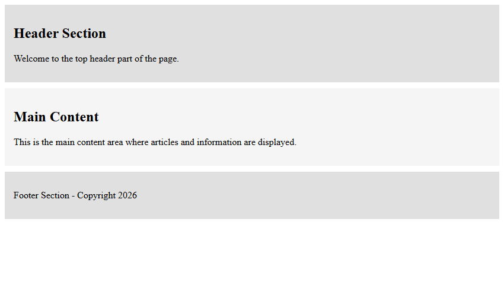
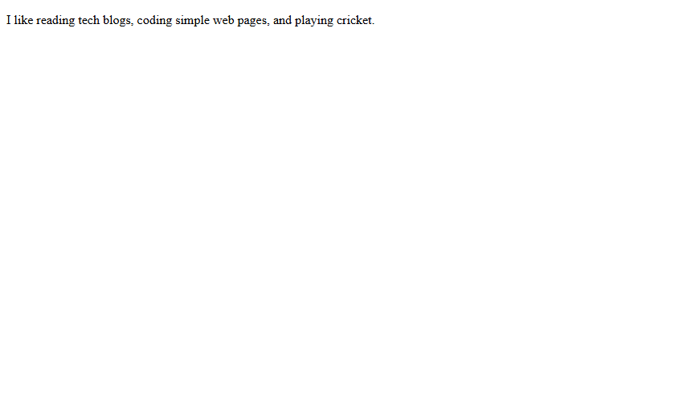

# Assignment 04: Divs, Attributes and a Small Fix

## 1. Experiment Title
Divs, Attributes and a Small Fix

## 2. Aim
Group parts of a page with div elements, add a data attribute, and fix the errors in a broken page.

## 3. Software / Tools Required
- **Language / Technologies:** HTML5, CSS3, Git
- **Text Editor / IDE:** Visual Studio Code / Modern Web Editor
- **Web Browser:** Google Chrome / Mozilla Firefox / Modern Browser

## 4. Theory
Structural division containers and element attributes:
- `<div>`: Generic container element for flow content, commonly used for CSS layout grouping.
- `class` attribute: Reusable identifier used to apply CSS rules across multiple elements.
- `id` attribute: Document-unique identifier for specific targets.
- `data-*` attributes: Embed custom application data on HTML elements without visual interference.
- Fixing malformed markup: Ensuring matching opening and closing tags and valid nesting.

## 5. Tasks, Source Code & Output

### Question 1: Structural Layout with Div Elements

**Problem Statement:**  
Create layout.html with three div blocks: header, main, and footer.

**Directory:** `Question1/`  

**Source File (`layout.html`):**

```html
<!--
  Student Name: Shivam Gupta
  Roll Number: 2510303486
  Assignment: 04 - Task 01 (Div Layout)
-->
<!DOCTYPE html>
<html lang="en">
<head>
  <meta charset="UTF-8">
  <title>Layout with Divs</title>
  <style>
    .header {
      background-color: #e0e0e0;
      padding: 15px;
      margin-bottom: 10px;
    }
    .main {
      background-color: #f5f5f5;
      padding: 15px;
      margin-bottom: 10px;
    }
    .footer {
      background-color: #e0e0e0;
      padding: 15px;
    }
  </style>
  <link rel="stylesheet" href="style.css">
</head>
<body>
  <div class="header">
    <h2>Header Section</h2>
    <p>Welcome to the top header part of the page.</p>
  </div>
  <div class="main">
    <h2>Main Content</h2>
    <p>This is the main content area where articles and information are displayed.</p>
  </div>
  <div class="footer">
    <p>Footer Section - Copyright 2026</p>
  </div>
</body>
</html>
```

**Source File (`style.css`):**

```css
/*
  Student Name: Shivam Gupta
  Roll Number: 2510303486
  Subject: HTML and CSS Introduction Lab (BCS352)
  University: Invertis University, Bareilly
*/
/* Page Layout Styles */
.header {
  background-color: #2563eb;
  color: white;
  padding: 16px;
  margin-bottom: 12px;
}
.main {
  background-color: #f1f5f9;
  padding: 20px;
  border: 1px solid #cbd5e1;
}
.footer {
  background-color: #1e293b;
  color: white;
  padding: 12px;
  margin-top: 12px;
  text-align: center;
}
```

**Output Screenshot:**



---

### Question 2: Div ID and Custom Data Attributes

**Problem Statement:**  
Create attributes.html with div id='profile' containing a paragraph with data-topic='hobbies'.

**Directory:** `Question2/`  

**Source File (`attributes.html`):**

```html
<!--
  Student Name: Shivam Gupta
  Roll Number: 2510303486
  Assignment: 04 - Task 02 (Attributes)
-->
<!DOCTYPE html>
<html lang="en">
<head>
  <meta charset="UTF-8">
  <title>Profile Attributes</title>
</head>
<body>
  <div id="profile">
    <p data-topic="hobbies">I like reading tech blogs, coding simple web pages, and playing cricket.</p>
  </div>
</body>
</html>
```

**Output Screenshot:**



---

### Question 3: Correcting Broken HTML Page (Attendance Report)

**Problem Statement:**  
Fix unclosed tags, bad nesting, and structural syntax errors in attendance-fixed.html.

**Directory:** `Question3/`  

**Source File (`attendance-fixed.html`):**

```html
<!--
  Student Name: Shivam Gupta
  Roll Number: 2510303486
  Assignment: 04 - Task 03 (Attendance Fixed)
-->
<!DOCTYPE html>
<html lang="en">
<head>
  <meta charset="UTF-8">
  <title>Attendance</title>
</head>
<body>
  <h1>Attendance Report</h1>
  <p>Asha: 92%</p>
  <p>Rohan: 85%</p>
</body>
</html>
```

**Output Screenshot:**


---

## 6. Result
Result: All three tasks for Assignment 04 (Divs, Attributes and a Small Fix) were successfully implemented, executed, and verified according to university lab specifications.
