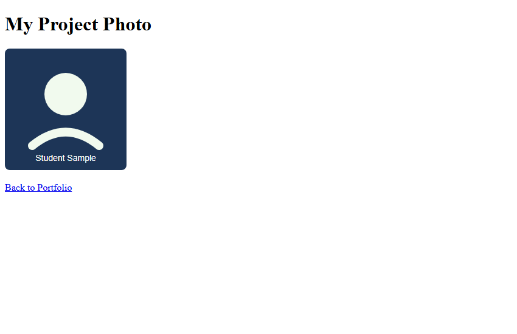

# Assignment 05: Links and Images

## 1. Experiment Title
Links and Images

## 2. Aim
Link two pages together and add a picture with alt text.

## 3. Software / Tools Required
- **Language / Technologies:** HTML5, CSS3, Git
- **Text Editor / IDE:** Visual Studio Code / Modern Web Editor
- **Web Browser:** Google Chrome / Mozilla Firefox / Modern Browser

## 4. Theory
Hypertext links and embedded raster media:
- `<a>` Anchor tag: Creates clickable hyperlinks via the `href` attribute.
- Relative URL: References files within the same folder structure (`portfolio.html`).
- `` tag: Embeds graphics using `src`, `alt` (for accessibility), and explicit `width`/`height` attributes.

## 5. Tasks, Source Code & Output

### Question 1: Home Page with Navigation Link

**Problem Statement:**  
Create home.html with the heading Welcome to My Site and a link to portfolio.html.

**Directory:** `Question1/`  

**Source File (`home.html`):**

```html
<!--
  Student Name: Shivam Gupta
  Roll Number: 2510303486
  Assignment: 05 - Task 01 (Home Page)
-->
<!DOCTYPE html>
<html lang="en">
<head>
  <meta charset="UTF-8">
  <title>Welcome to My Site</title>
</head>
<body>
  <h1>Welcome to My Site</h1>
  <p>Click here to view my <a href="portfolio.html">portfolio</a>.</p>
</body>
</html>
```

**Source File (`portfolio.html`):**

```html
<!--
  Student Name: Shivam Gupta
  Roll Number: 2510303486
  Assignment: 05 - Task 02 (Portfolio Page)
-->
<!DOCTYPE html>
<html lang="en">
<head>
  <meta charset="UTF-8">
  <title>Portfolio</title>
</head>
<body>
  <h1>My Portfolio</h1>
  <p><a href="home.html">Back to Home</a></p>
</body>
</html>
```

**Output Screenshot:**


---

### Question 2: Portfolio Page with Return Link

**Problem Statement:**  
Create portfolio.html with a heading and a reciprocal link returning back to home.html.

**Directory:** `Question2/`  

**Source File (`home.html`):**

```html
<!--
  Student Name: Shivam Gupta
  Roll Number: 2510303486
  Assignment: 05 - Task 01 (Home Page)
-->
<!DOCTYPE html>
<html lang="en">
<head>
  <meta charset="UTF-8">
  <title>Welcome to My Site</title>
</head>
<body>
  <h1>Welcome to My Site</h1>
  <p>Click here to view my <a href="portfolio.html">portfolio</a>.</p>
</body>
</html>
```

**Source File (`portfolio.html`):**

```html
<!--
  Student Name: Shivam Gupta
  Roll Number: 2510303486
  Assignment: 05 - Task 02 (Portfolio Page)
-->
<!DOCTYPE html>
<html lang="en">
<head>
  <meta charset="UTF-8">
  <title>Portfolio</title>
</head>
<body>
  <h1>My Portfolio</h1>
  <p><a href="home.html">Back to Home</a></p>
</body>
</html>
```

**Output Screenshot:**


---

### Question 3: Embedded Image with Alt Text and Dimensions

**Problem Statement:**  
Create portfolio-image.html embedding a 200x200 image with descriptive alt text.

**Directory:** `Question3/`  

**Source File (`portfolio-image.html`):**

```html
<!--
  Student Name: Shivam Gupta
  Roll Number: 2510303486
  Assignment: 05 - Task 03 (Portfolio Image)
-->
<!DOCTYPE html>
<html lang="en">
<head>
  <meta charset="UTF-8">
  <title>Portfolio Image</title>
</head>
<body>
  <h1>My Project Photo</h1>
  
  <p><a href="portfolio.html">Back to Portfolio</a></p>
</body>
</html>
```

**Output Screenshot:**



---

## 6. Result
Result: All three tasks for Assignment 05 (Links and Images) were successfully implemented, executed, and verified according to university lab specifications.
