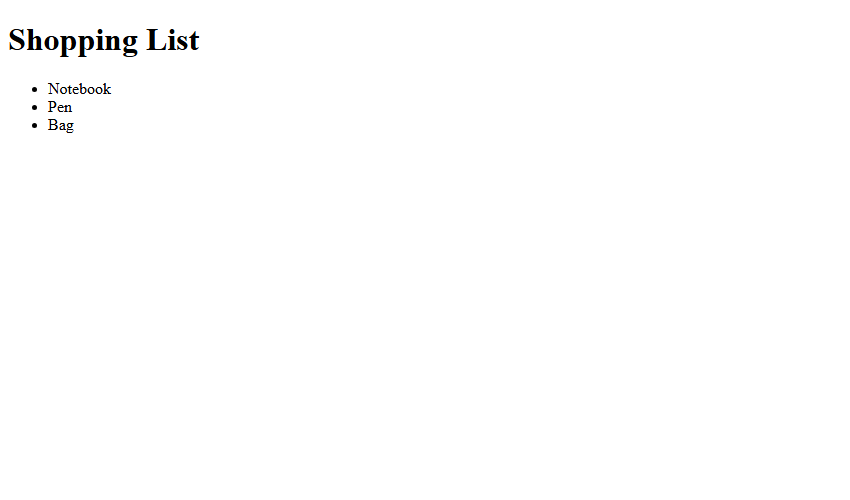
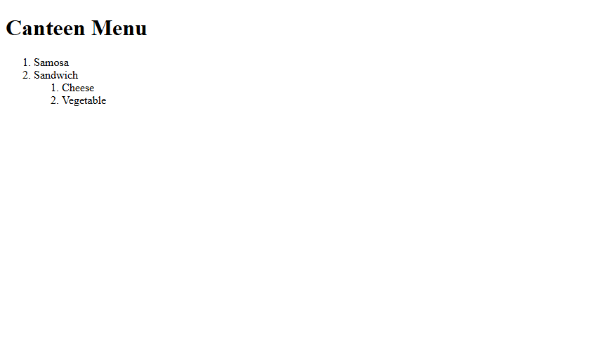
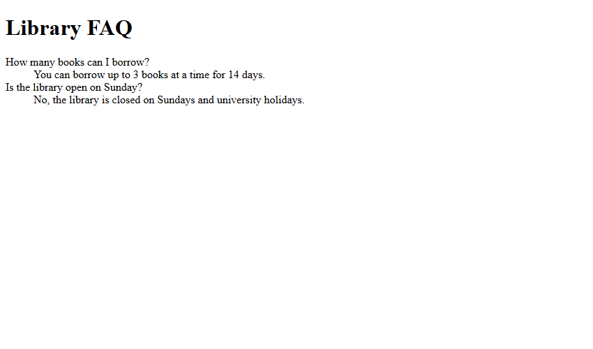

# Assignment 06: Types of HTML Lists

## 1. Experiment Title
Types of HTML Lists

## 2. Aim
Make a bulleted list, a numbered list with a nested list, and a description list.

## 3. Software / Tools Required
- **Language / Technologies:** HTML5, CSS3, Git
- **Text Editor / IDE:** Visual Studio Code / Modern Web Editor
- **Web Browser:** Google Chrome / Mozilla Firefox / Modern Browser

## 4. Theory
HTML list element types:
- `<ul>`: Unordered bulleted list for non-sequential collections.
- `<ol>`: Ordered numbered list with sequential indices, supporting hierarchical nesting.
- `<dl>`: Description list pairing terms (`<dt>`) with corresponding definitions (`<dd>`).

## 5. Tasks, Source Code & Output

### Question 1: Unordered Bulleted Shopping List

**Problem Statement:**  
Create shopping-list.html with heading Shopping List and unordered items: Notebook, Pen, Bag.

**Directory:** `Question1/`  

**Source File (`shopping-list.html`):**

```html
<!--
  Student Name: Shivam Gupta
  Roll Number: 2510303486
  Assignment: 06 - Task 01 (Shopping List)
-->
<!DOCTYPE html>
<html lang="en">
<head>
  <meta charset="UTF-8">
  <title>Shopping List</title>
</head>
<body>
  <h1>Shopping List</h1>
  <ul>
    <li>Notebook</li>
    <li>Pen</li>
    <li>Bag</li>
  </ul>
</body>
</html>
```

**Output Screenshot:**



---

### Question 2: Ordered List with Nested Sub-List

**Problem Statement:**  
Create canteen-menu.html with numbered items (Samosa, Sandwich) and nested sub-items (Cheese, Vegetable).

**Directory:** `Question2/`  

**Source File (`canteen-menu.html`):**

```html
<!--
  Student Name: Shivam Gupta
  Roll Number: 2510303486
  Assignment: 06 - Task 02 (Canteen Menu)
-->
<!DOCTYPE html>
<html lang="en">
<head>
  <meta charset="UTF-8">
  <title>Canteen Menu</title>
</head>
<body>
  <h1>Canteen Menu</h1>
  <ol>
    <li>Samosa</li>
    <li>Sandwich
      <ol>
        <li>Cheese</li>
        <li>Vegetable</li>
      </ol>
    </li>
  </ol>
</body>
</html>
```

**Output Screenshot:**



---

### Question 3: Description List (FAQ)

**Problem Statement:**  
Create faq.html utilizing dl, dt, and dd tags to format question-and-answer pairs.

**Directory:** `Question3/`  

**Source File (`faq.html`):**

```html
<!--
  Student Name: Shivam Gupta
  Roll Number: 2510303486
  Assignment: 06 - Task 03 (FAQ Description List)
-->
<!DOCTYPE html>
<html lang="en">
<head>
  <meta charset="UTF-8">
  <title>Library FAQ</title>
</head>
<body>
  <h1>Library FAQ</h1>
  <dl>
    <dt>How many books can I borrow?</dt>
    <dd>You can borrow up to 3 books at a time for 14 days.</dd>
    <dt>Is the library open on Sunday?</dt>
    <dd>No, the library is closed on Sundays and university holidays.</dd>
  </dl>
</body>
</html>
```

**Output Screenshot:**



---

## 6. Result
Result: All three tasks for Assignment 06 (Types of HTML Lists) were successfully implemented, executed, and verified according to university lab specifications.
