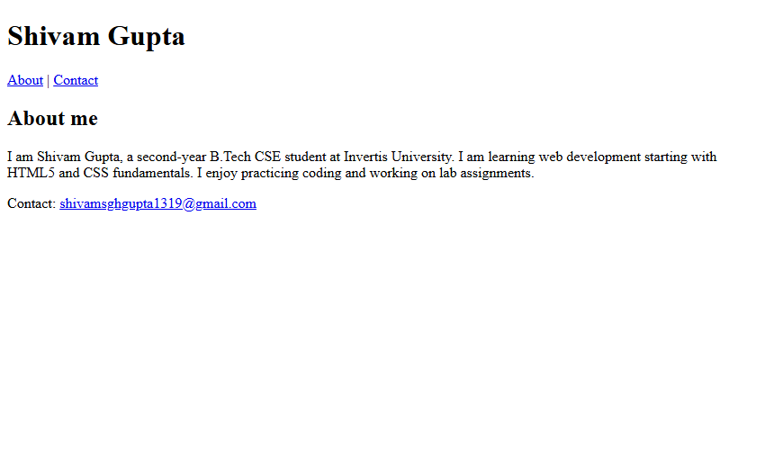

# Assignment 07: About Me Page

## 1. Experiment Title
About Me Page

## 2. Aim
Build a short About Me page with semantic tags, an about section and a contact link.

## 3. Software / Tools Required
- **Language / Technologies:** HTML5, CSS3, Git
- **Text Editor / IDE:** Visual Studio Code / Modern Web Editor
- **Web Browser:** Google Chrome / Mozilla Firefox / Modern Browser

## 4. Theory
Semantic HTML5 layout architecture:
- `<header>`: Introduces navigational links and main page title.
- `<nav>`: Dedicated container for site navigation links.
- `<main>`: Central unique content of the web page.
- `<section>`: Thematic content block.
- `<footer>`: Concluding metadata, copyright, and contact links.
- `mailto:`: Protocol scheme launching the user's default email client.

## 5. Tasks, Source Code & Output

### Question 1: Semantic Header and Navigation Links

**Problem Statement:**  
Create about-me.html with header containing h1 and nav links jumping to #about and #contact.

**Directory:** `Question1/`  

**Source File (`about-me.html`):**

```html
<!--
  Student Name: Shivam Gupta
  Roll Number: 2510303486
  Assignment: 07 - Task 01-03 (About Me Page)
-->
<!DOCTYPE html>
<html lang="en">
<head>
  <meta charset="UTF-8">
  <title>About Me</title>
</head>
<body>
  <header>
    <h1>Shivam Gupta</h1>
    <nav>
      <a href="#about">About</a> |
      <a href="#contact">Contact</a>
    </nav>
  </header>

  <main>
    <section id="about">
      <h2>About me</h2>
      <p>I am Shivam Gupta, a second-year B.Tech CSE student at Invertis University. I am learning web development starting with HTML5 and CSS fundamentals. I enjoy practicing coding and working on lab assignments.</p>
    </section>
  </main>

  <footer id="contact">
    <p>Contact: <a href="mailto:shivamsghgupta1319@gmail.com">shivamsghgupta1319@gmail.com</a></p>
  </footer>
</body>
</html>
```

**Output Screenshot:**


---

### Question 2: Main Content and About Me Section

**Problem Statement:**  
Add section with id='about' inside main containing h2 heading and biography paragraph.

**Directory:** `Question2/`  

**Source File (`about-me.html`):**

```html
<!--
  Student Name: Shivam Gupta
  Roll Number: 2510303486
  Assignment: 07 - Task 01-03 (About Me Page)
-->
<!DOCTYPE html>
<html lang="en">
<head>
  <meta charset="UTF-8">
  <title>About Me</title>
</head>
<body>
  <header>
    <h1>Shivam Gupta</h1>
    <nav>
      <a href="#about">About</a> |
      <a href="#contact">Contact</a>
    </nav>
  </header>

  <main>
    <section id="about">
      <h2>About me</h2>
      <p>I am Shivam Gupta, a second-year B.Tech CSE student at Invertis University. I am learning web development starting with HTML5 and CSS fundamentals. I enjoy practicing coding and working on lab assignments.</p>
    </section>
  </main>

  <footer id="contact">
    <p>Contact: <a href="mailto:shivamsghgupta1319@gmail.com">shivamsghgupta1319@gmail.com</a></p>
  </footer>
</body>
</html>
```

**Output Screenshot:**


---

### Question 3: Footer with Clickable Mailto Contact Link

**Problem Statement:**  
Add footer with id='contact' containing a mailto: link to your email address.

**Directory:** `Question3/`  

**Source File (`about-me.html`):**

```html
<!--
  Student Name: Shivam Gupta
  Roll Number: 2510303486
  Assignment: 07 - Task 01-03 (About Me Page)
-->
<!DOCTYPE html>
<html lang="en">
<head>
  <meta charset="UTF-8">
  <title>About Me</title>
</head>
<body>
  <header>
    <h1>Shivam Gupta</h1>
    <nav>
      <a href="#about">About</a> |
      <a href="#contact">Contact</a>
    </nav>
  </header>

  <main>
    <section id="about">
      <h2>About me</h2>
      <p>I am Shivam Gupta, a second-year B.Tech CSE student at Invertis University. I am learning web development starting with HTML5 and CSS fundamentals. I enjoy practicing coding and working on lab assignments.</p>
    </section>
  </main>

  <footer id="contact">
    <p>Contact: <a href="mailto:shivamsghgupta1319@gmail.com">shivamsghgupta1319@gmail.com</a></p>
  </footer>
</body>
</html>
```

**Output Screenshot:**



---

## 6. Result
Result: All three tasks for Assignment 07 (About Me Page) were successfully implemented, executed, and verified according to university lab specifications.
