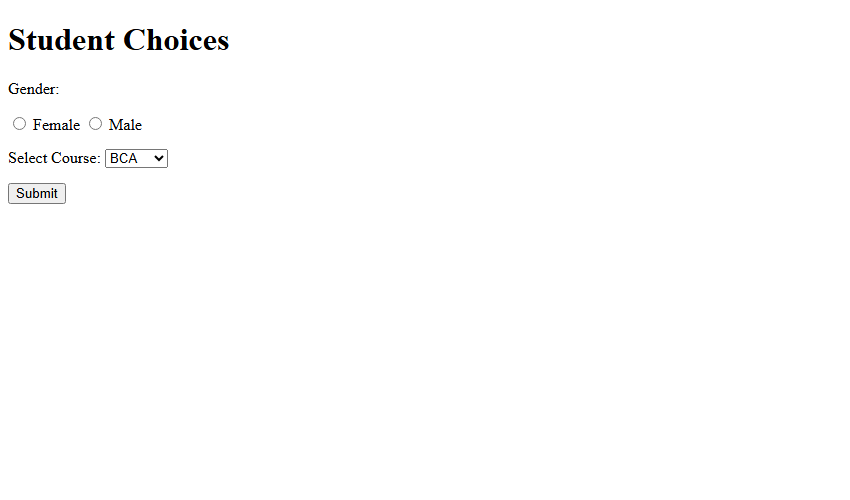
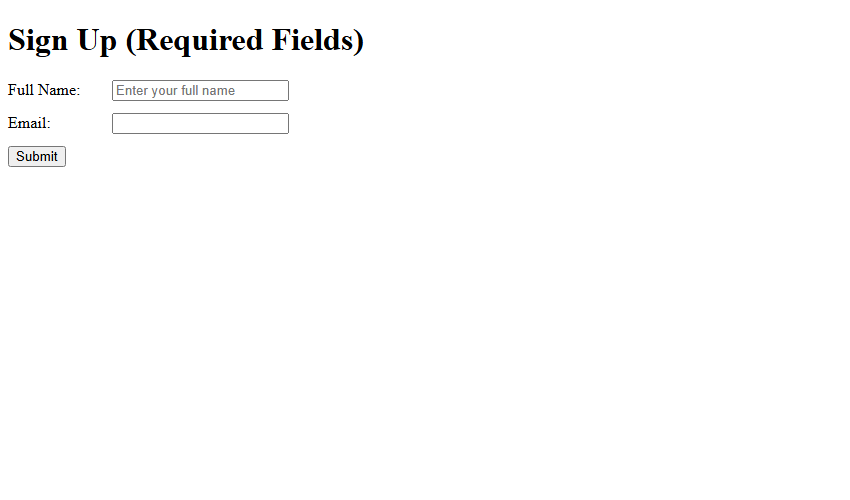

# Assignment 08: Sign-Up Forms and Choices

## 1. Experiment Title
Sign-Up Forms and Choices

## 2. Aim
Make a labelled form with text, email and password fields, choices and a submit button.

## 3. Software / Tools Required
- **Language / Technologies:** HTML5, CSS3, Git
- **Text Editor / IDE:** Visual Studio Code / Modern Web Editor
- **Web Browser:** Google Chrome / Mozilla Firefox / Modern Browser

## 4. Theory
HTML form controls and client-side constraints:
- `<form>`: Interactive container dispatching inputs via HTTP POST/GET.
- `<label>`: Bound to inputs with matching `for` and `id` attributes.
- Input controls: `type="text"`, `type="email"`, `type="password"`, `type="radio"`.
- `<select>` / `<option>`: Dropdown selection lists.
- HTML5 validation: `required` attribute triggers automatic browser constraint checking.

## 5. Tasks, Source Code & Output

### Question 1: Labelled Form with Input Fields

**Problem Statement:**  
Create signup.html with labelled fields for Full Name, Email, and Password.

**Directory:** `Question1/`  

**Source File (`signup.html`):**

```html
<!--
  Student Name: Shivam Gupta
  Roll Number: 2510303486
  Assignment: 08 - Task 01 (Sign Up Form)
-->
<!DOCTYPE html>
<html lang="en">
<head>
  <meta charset="UTF-8">
  <title>Sign Up</title>
  <style>
    .field {
      margin-bottom: 12px;
    }
    label {
      display: inline-block;
      width: 100px;
    }
  </style>
</head>
<body>
  <h1>Sign Up Form</h1>
  <form method="post" action="thanks.html">
    <div class="field">
      <label for="fullname">Full Name:</label>
      <input type="text" id="fullname" name="fullname">
    </div>
    <div class="field">
      <label for="email">Email:</label>
      <input type="email" id="email" name="email">
    </div>
    <div class="field">
      <label for="password">Password:</label>
      <input type="password" id="password" name="password">
    </div>
    <input type="submit" value="Sign Up">
  </form>
</body>
</html>
```

**Source File (`thanks.html`):**

```html
<!--
  Student Name: Shivam Gupta
  Roll Number: 2510303486
  Assignment: 08 - Task 00 (Thank You Page)
-->
<!DOCTYPE html>
<html lang="en">
<head>
  <meta charset="UTF-8">
  <title>Thanks</title>
</head>
<body>
  <h1>Thank You!</h1>
  <p>Your details have been submitted successfully.</p>
  <p><a href="signup.html">Back to Sign Up</a></p>
</body>
</html>
```

**Output Screenshot:**


---

### Question 2: Radio Buttons and Select Dropdown

**Problem Statement:**  
Create choices.html with radio buttons for gender and select dropdown for course (BCA/B.Tech).

**Directory:** `Question2/`  

**Source File (`choices.html`):**

```html
<!--
  Student Name: Shivam Gupta
  Roll Number: 2510303486
  Assignment: 08 - Task 02 (Choices Form)
-->
<!DOCTYPE html>
<html lang="en">
<head>
  <meta charset="UTF-8">
  <title>Choices</title>
  <style>
    .field {
      margin-bottom: 15px;
    }
  </style>
</head>
<body>
  <h1>Student Choices</h1>
  <form>
    <div class="field">
      <p>Gender:</p>
      <label>
        <input type="radio" name="gender" value="Female"> Female
      </label>
      <label>
        <input type="radio" name="gender" value="Male"> Male
      </label>
    </div>

    <div class="field">
      <label for="course">Select Course:</label>
      <select name="course" id="course">
        <option value="BCA">BCA</option>
        <option value="B.Tech">B.Tech</option>
      </select>
    </div>

    <input type="submit" value="Submit">
  </form>
</body>
</html>
```

**Output Screenshot:**



---

### Question 3: HTML5 Form Validation and Required Fields

**Problem Statement:**  
Create signup-required.html with required fields, placeholders, and a Submit button.

**Directory:** `Question3/`  

**Source File (`signup-required.html`):**

```html
<!--
  Student Name: Shivam Gupta
  Roll Number: 2510303486
  Assignment: 08 - Task 03 (Required Fields Form)
-->
<!DOCTYPE html>
<html lang="en">
<head>
  <meta charset="UTF-8">
  <title>Sign Up (Required)</title>
  <style>
    .field {
      margin-bottom: 12px;
    }
    label {
      display: inline-block;
      width: 100px;
    }
  </style>
</head>
<body>
  <h1>Sign Up (Required Fields)</h1>
  <form method="post" action="thanks.html">
    <div class="field">
      <label for="fullname">Full Name:</label>
      <input type="text" id="fullname" name="fullname" placeholder="Enter your full name" required>
    </div>
    <div class="field">
      <label for="email">Email:</label>
      <input type="email" id="email" name="email" required>
    </div>
    <input type="submit" value="Submit">
  </form>
</body>
</html>
```

**Output Screenshot:**



---

## 6. Result
Result: All three tasks for Assignment 08 (Sign-Up Forms and Choices) were successfully implemented, executed, and verified according to university lab specifications.
