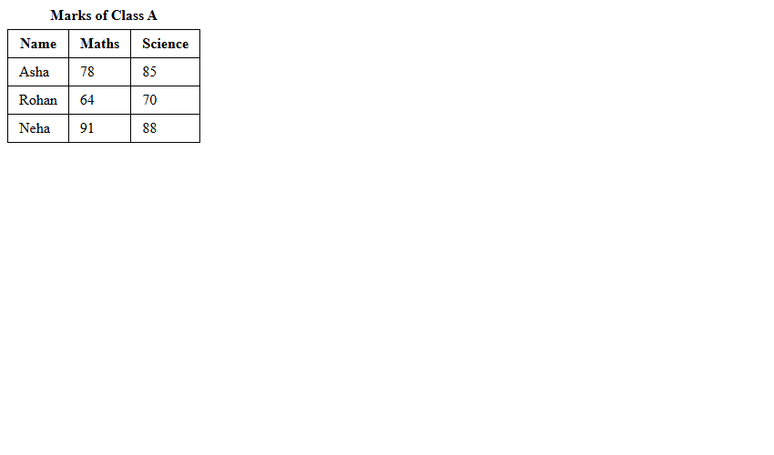
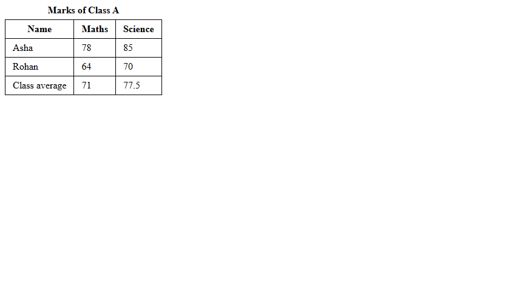
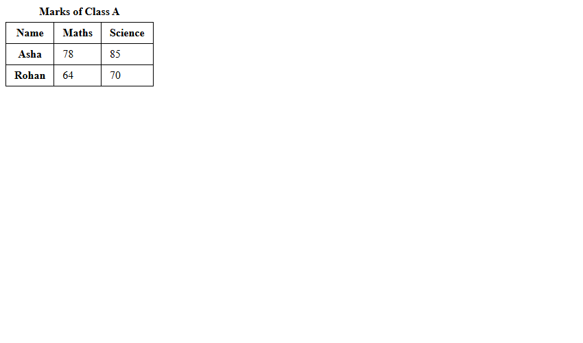

# Assignment 09: Tables with Headers and Footers

## 1. Experiment Title
Tables with Headers and Footers

## 2. Aim
Build a table with a caption, a header, rows and a footer, and add scope attributes.

## 3. Software / Tools Required
- **Language / Technologies:** HTML5, CSS3, Git
- **Text Editor / IDE:** Visual Studio Code / Modern Web Editor
- **Web Browser:** Google Chrome / Mozilla Firefox / Modern Browser

## 4. Theory
Tabular data presentation and accessibility markup:
- `<table>`: Root tabular data container.
- `<caption>`: Accessible title placed immediately after table opening tag.
- `<thead>`: Groups column header rows (`<th>`).
- `<tbody>`: Groups core tabular records (`<td>`).
- `<tfoot>`: Summary/aggregate row positioned at bottom.
- `scope`: Communicates column (`scope="col"`) or row (`scope="row"`) header relationships to screen readers.

## 5. Tasks, Source Code & Output

### Question 1: Marks Table with Caption, Thead and Tbody

**Problem Statement:**  
Create marks.html with caption 'Marks of Class A', thead headers, and 3 student rows.

**Directory:** `Question1/`  

**Source File (`marks.html`):**

```html
<!--
  Student Name: Shivam Gupta
  Roll Number: 2510303486
  Assignment: 09 - Task 01 (Marks Table)
-->
<!DOCTYPE html>
<html lang="en">
<head>
  <meta charset="UTF-8">
  <title>Marks of Class A</title>
  <style>
    table, th, td {
      border: 1px solid black;
      border-collapse: collapse;
      padding: 6px 12px;
    }
    caption {
      font-weight: bold;
      margin-bottom: 6px;
    }
  </style>
</head>
<body>
  <table>
    <caption>Marks of Class A</caption>
    <thead>
      <tr>
        <th>Name</th>
        <th>Maths</th>
        <th>Science</th>
      </tr>
    </thead>
    <tbody>
      <tr>
        <td>Asha</td>
        <td>78</td>
        <td>85</td>
      </tr>
      <tr>
        <td>Rohan</td>
        <td>64</td>
        <td>70</td>
      </tr>
      <tr>
        <td>Neha</td>
        <td>91</td>
        <td>88</td>
      </tr>
    </tbody>
  </table>
</body>
</html>
```

**Output Screenshot:**



---

### Question 2: Table with Tfoot Calculating Class Average

**Problem Statement:**  
Create marks-average.html adding tfoot to calculate and display class average.

**Directory:** `Question2/`  

**Source File (`marks-average.html`):**

```html
<!--
  Student Name: Shivam Gupta
  Roll Number: 2510303486
  Assignment: 09 - Task 02 (Marks Table with Average)
-->
<!DOCTYPE html>
<html lang="en">
<head>
  <meta charset="UTF-8">
  <title>Marks with Average</title>
  <style>
    table, th, td {
      border: 1px solid black;
      border-collapse: collapse;
      padding: 6px 12px;
    }
    caption {
      font-weight: bold;
      margin-bottom: 6px;
    }
  </style>
</head>
<body>
  <table>
    <caption>Marks of Class A</caption>
    <thead>
      <tr>
        <th>Name</th>
        <th>Maths</th>
        <th>Science</th>
      </tr>
    </thead>
    <tbody>
      <tr>
        <td>Asha</td>
        <td>78</td>
        <td>85</td>
      </tr>
      <tr>
        <td>Rohan</td>
        <td>64</td>
        <td>70</td>
      </tr>
    </tbody>
    <tfoot>
      <tr>
        <td>Class average</td>
        <td>71</td>
        <td>77.5</td>
      </tr>
    </tfoot>
  </table>
</body>
</html>
```

**Output Screenshot:**



---

### Question 3: Accessible Table with Col and Row Scope Attributes

**Problem Statement:**  
Create marks-accessible.html implementing scope='col' and scope='row' on header cells.

**Directory:** `Question3/`  

**Source File (`marks-accessible.html`):**

```html
<!--
  Student Name: Shivam Gupta
  Roll Number: 2510303486
  Assignment: 09 - Task 03 (Accessible Marks Table)
-->
<!DOCTYPE html>
<html lang="en">
<head>
  <meta charset="UTF-8">
  <title>Accessible Marks Table</title>
  <style>
    table, th, td {
      border: 1px solid black;
      border-collapse: collapse;
      padding: 6px 12px;
    }
    caption {
      font-weight: bold;
      margin-bottom: 6px;
    }
  </style>
</head>
<body>
  <table>
    <caption>Marks of Class A</caption>
    <thead>
      <tr>
        <th scope="col">Name</th>
        <th scope="col">Maths</th>
        <th scope="col">Science</th>
      </tr>
    </thead>
    <tbody>
      <tr>
        <th scope="row">Asha</th>
        <td>78</td>
        <td>85</td>
      </tr>
      <tr>
        <th scope="row">Rohan</th>
        <td>64</td>
        <td>70</td>
      </tr>
    </tbody>
  </table>
</body>
</html>
```

**Output Screenshot:**



---

## 6. Result
Result: All three tasks for Assignment 09 (Tables with Headers and Footers) were successfully implemented, executed, and verified according to university lab specifications.
