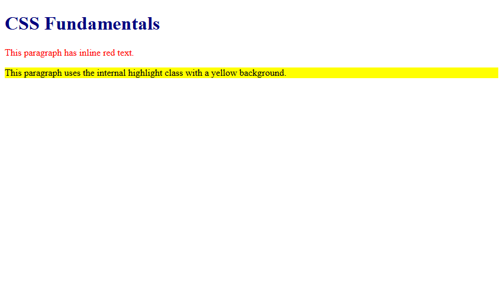
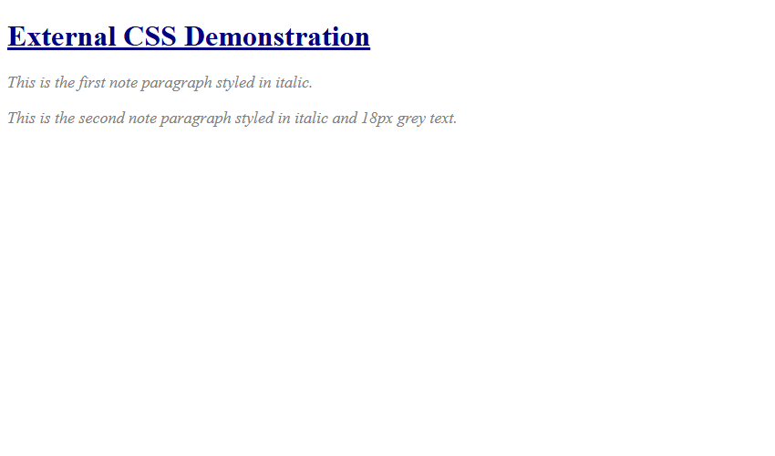

# Assignment 10: CSS Fundamentals

## 1. Experiment Title
CSS Fundamentals

## 2. Aim
Apply CSS in three ways (inline, internal and linked) and use selectors and text styles.

## 3. Software / Tools Required
- **Language / Technologies:** HTML5, CSS3, Git
- **Text Editor / IDE:** Visual Studio Code / Modern Web Editor
- **Web Browser:** Google Chrome / Mozilla Firefox / Modern Browser

## 4. Theory
CSS application methods and core selector taxonomy:
- **Inline style**: Applied directly onto element tag via `style="..."` attribute.
- **Internal style**: Declared inside `<style>` tags within `<head>`.
- **Linked external style**: Included with `<link rel="stylesheet" href="style.css">`.
- **Selectors**: Element tag selector, class selector (`.note`), and ID selector (`#title`).

## 5. Tasks, Source Code & Output

### Question 1: Internal Stylesheet and Inline Styling

**Problem Statement:**  
Create inline-internal.html with internal style (navy h1, yellow highlight) and inline red style.

**Directory:** `Question1/`  

**Source File (`inline-internal.html`):**

```html
<!--
  Student Name: Shivam Gupta
  Roll Number: 2510303486
  Assignment: 10 - Task 01 (Inline and Internal CSS)
-->
<!DOCTYPE html>
<html lang="en">
<head>
  <meta charset="UTF-8">
  <title>Inline and Internal CSS</title>
  <style>
    h1 {
      color: navy;
    }
    .highlight {
      background-color: yellow;
    }
  </style>
  <link rel="stylesheet" href="style.css">
</head>
<body>
  <h1>CSS Fundamentals</h1>
  <p style="color: red;">This paragraph has inline red text.</p>
  <p class="highlight">This paragraph uses the internal highlight class with a yellow background.</p>
</body>
</html>
```

**Source File (`style.css`):**

```css
/*
  Student Name: Shivam Gupta
  Roll Number: 2510303486
  Subject: HTML and CSS Introduction Lab (BCS352)
  University: Invertis University, Bareilly
*/
/* Internal/Inline Demo Styles */
h1 {
  color: navy;
}
.highlight {
  background-color: yellow;
}
```

**Output Screenshot:**



---

### Question 2: External CSS Rules (Element, Class, ID Selectors)

**Problem Statement:**  
Create style.css with rules for h1 (navy), .note (italic), #title (underlined), and p (18px, grey).

**Directory:** `Question2/`  

**Source File (`style.css`):**

```css
/*
  Student Name: Shivam Gupta
  Roll Number: 2510303486
  Subject: HTML and CSS Introduction Lab (BCS352)
  University: Invertis University, Bareilly
*/
/* Fundamental Selectors */
h1 {
  color: navy;
}
.note {
  font-style: italic;
}
#title {
  text-decoration: underline;
}
p {
  font-size: 18px;
  color: #555555;
}
```

**Output Screenshot:**



---

### Question 3: Linked External Stylesheet Demonstration

**Problem Statement:**  
Create linked.html that links style.css with #title and .note paragraphs.

**Directory:** `Question3/`  

**Source File (`linked.html`):**

```html
<!--
  Student Name: Shivam Gupta
  Roll Number: 2510303486
  Assignment: 10 - Task 03 (Linked External CSS)
-->
<!DOCTYPE html>
<html lang="en">
<head>
  <meta charset="UTF-8">
  <title>Linked Stylesheet</title>
  <link rel="stylesheet" href="style.css">
</head>
<body>
  <h1 id="title">External CSS Demonstration</h1>
  <p class="note">This is the first note paragraph styled in italic.</p>
  <p class="note">This is the second note paragraph styled in italic and 18px grey text.</p>
</body>
</html>
```

**Source File (`style.css`):**

```css
/*
  Student Name: Shivam Gupta
  Roll Number: 2510303486
  Subject: HTML and CSS Introduction Lab (BCS352)
  University: Invertis University, Bareilly
*/
/* External Linked Stylesheet */
h1 {
  color: navy;
}
.note {
  font-style: italic;
}
#title {
  text-decoration: underline;
}
p {
  font-size: 18px;
  color: #555555;
}
```

**Output Screenshot:**


---

## 6. Result
Result: All three tasks for Assignment 10 (CSS Fundamentals) were successfully implemented, executed, and verified according to university lab specifications.
