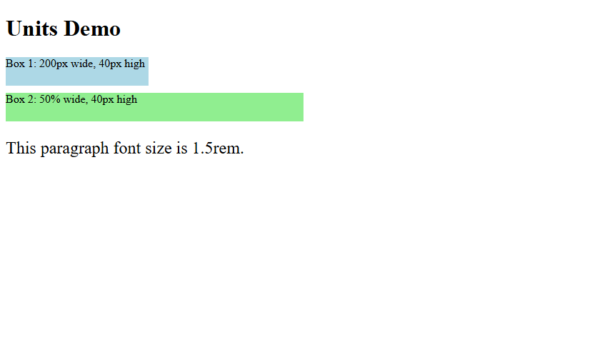
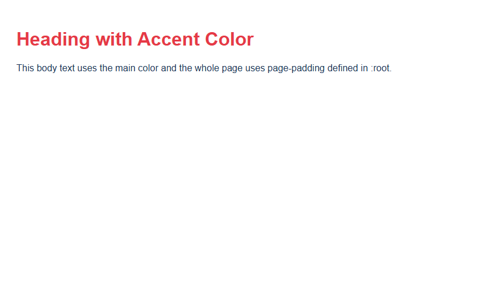
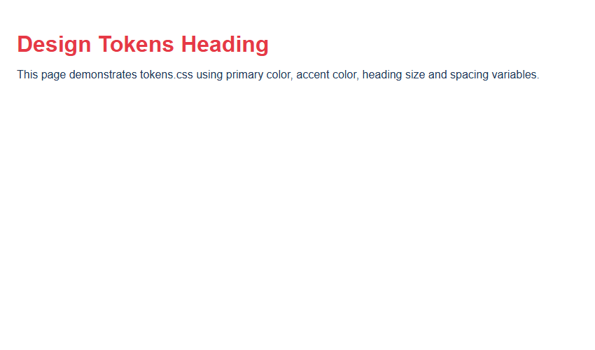

# Assignment 11: Units and CSS Variables

## 1. Experiment Title
Units and CSS Variables

## 2. Aim
Use CSS units and store colours and spacing in variables.

## 3. Software / Tools Required
- **Language / Technologies:** HTML5, CSS3, Git
- **Text Editor / IDE:** Visual Studio Code / Modern Web Editor
- **Web Browser:** Google Chrome / Mozilla Firefox / Modern Browser

## 4. Theory
CSS sizing units and Custom Properties:
- Absolute unit (`px`): Fixed physical pixels.
- Relative unit (`%`): Proportional to parent dimension.
- Relative unit (`rem`): Scaled relative to root `<html>` font size (16px default).
- CSS Variables: Declared on `:root` with `--variable-name` and accessed via `var(--variable-name)`.

## 5. Tasks, Source Code & Output

### Question 1: CSS Units (Pixels, Percentages, and Rem)

**Problem Statement:**  
Create units.html with 200px box, 50% box, and 1.5rem font size paragraph.

**Directory:** `Question1/`  

**Source File (`style.css`):**

```css
/*
  Student Name: Shivam Gupta
  Roll Number: 2510303486
  Subject: HTML and CSS Introduction Lab (BCS352)
  University: Invertis University, Bareilly
*/
/* Sizing Units */
.pixel-box {
  width: 200px;
  height: 40px;
  background-color: #38bdf8;
  margin-bottom: 12px;
}
.percent-box {
  width: 50%;
  height: 40px;
  background-color: #4ade80;
  margin-bottom: 12px;
}
.rem-text {
  font-size: 1.5rem;
  color: #1e293b;
}
```

**Source File (`units.html`):**

```html
<!--
  Student Name: Shivam Gupta
  Roll Number: 2510303486
  Assignment: 11 - Task 01 (CSS Units)
-->
<!DOCTYPE html>
<html lang="en">
<head>
  <meta charset="UTF-8">
  <title>CSS Units</title>
  <style>
    .box1 {
      width: 200px;
      height: 40px;
      background-color: lightblue;
      margin-bottom: 10px;
    }
    .box2 {
      width: 50%;
      height: 40px;
      background-color: lightgreen;
      margin-bottom: 10px;
    }
    p {
      font-size: 1.5rem;
    }
  </style>
  <link rel="stylesheet" href="style.css">
</head>
<body>
  <h1>Units Demo</h1>
  <div class="box1">Box 1: 200px wide, 40px high</div>
  <div class="box2">Box 2: 50% wide, 40px high</div>
  <p>This paragraph font size is 1.5rem.</p>
</body>
</html>
```

**Output Screenshot:**



---

### Question 2: CSS Custom Properties (:root Variables)

**Problem Statement:**  
Create variables.html declaring --main-color, --accent-color, and --page-padding on :root.

**Directory:** `Question2/`  

**Source File (`style.css`):**

```css
/*
  Student Name: Shivam Gupta
  Roll Number: 2510303486
  Subject: HTML and CSS Introduction Lab (BCS352)
  University: Invertis University, Bareilly
*/
:root {
  --main-color: #1d3557;
  --accent-color: #e63946;
  --page-padding: 20px;
}
body {
  color: var(--main-color);
  padding: var(--page-padding);
  font-family: Arial, sans-serif;
}
h1 {
  color: var(--accent-color);
}
```

**Source File (`variables.html`):**

```html
<!--
  Student Name: Shivam Gupta
  Roll Number: 2510303486
  Assignment: 11 - Task 02 (CSS Variables)
-->
<!DOCTYPE html>
<html lang="en">
<head>
  <meta charset="UTF-8">
  <title>CSS Variables</title>
  <style>
    :root {
      --main-color: #1d3557;
      --accent-color: #e63946;
      --page-padding: 20px;
    }
    body {
      color: var(--main-color);
      padding: var(--page-padding);
      font-family: Arial, sans-serif;
    }
    h1 {
      color: var(--accent-color);
    }
  </style>
  <link rel="stylesheet" href="style.css">
</head>
<body>
  <h1>Heading with Accent Color</h1>
  <p>This body text uses the main color and the whole page uses page-padding defined in :root.</p>
</body>
</html>
```

**Output Screenshot:**



---

### Question 3: Design Tokens Stylesheet (tokens.css)

**Problem Statement:**  
Create tokens.css with color, heading size, and spacing variables, tested in tokens-demo.html.

**Directory:** `Question3/`  

**Source File (`tokens-demo.html`):**

```html
<!--
  Student Name: Shivam Gupta
  Roll Number: 2510303486
  Assignment: 11 - Task 03 (Tokens Demo)
-->
<!DOCTYPE html>
<html lang="en">
<head>
  <meta charset="UTF-8">
  <title>Tokens Demo</title>
  <link rel="stylesheet" href="tokens.css">
</head>
<body>
  <h1>Design Tokens Heading</h1>
  <p>This page demonstrates tokens.css using primary color, accent color, heading size and spacing variables.</p>
</body>
</html>
```

**Source File (`tokens.css`):**

```css
/*
  Student Name: Shivam Gupta
  Roll Number: 2510303486
  Assignment: 11 - Task 03 (Tokens CSS)
*/
:root {
  --primary-color: #1d3557;
  --accent-color: #e63946;
  --heading-size: 2rem;
  --spacing: 16px;
}

body {
  color: var(--primary-color);
  padding: var(--spacing);
  font-family: Arial, sans-serif;
}

h1 {
  color: var(--accent-color);
  font-size: var(--heading-size);
  margin-bottom: var(--spacing);
}
```

**Output Screenshot:**



---

## 6. Result
Result: All three tasks for Assignment 11 (Units and CSS Variables) were successfully implemented, executed, and verified according to university lab specifications.
