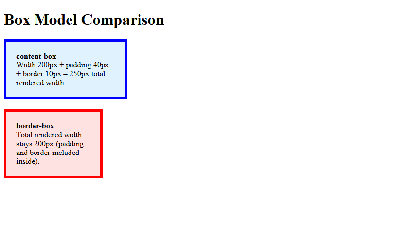
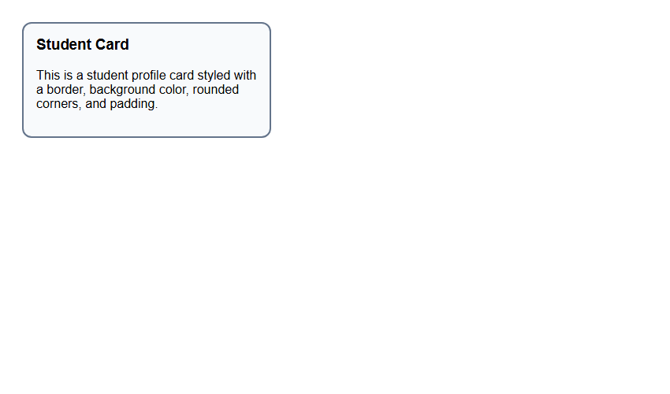
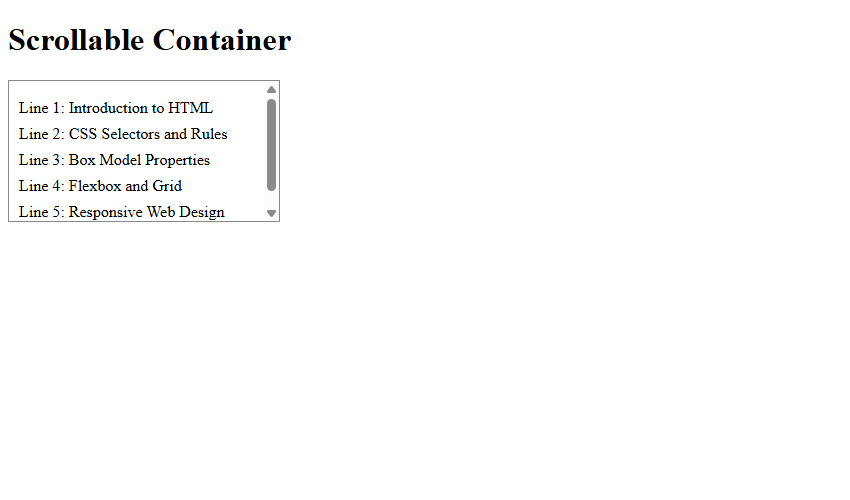

# Assignment 12: Box Model, Cards and Scrolling

## 1. Experiment Title
Box Model, Cards and Scrolling

## 2. Aim
Compare the box sizing types, style a card and make a box scroll.

## 3. Software / Tools Required
- **Language / Technologies:** HTML5, CSS3, Git
- **Text Editor / IDE:** Visual Studio Code / Modern Web Editor
- **Web Browser:** Google Chrome / Mozilla Firefox / Modern Browser

## 4. Theory
CSS Box Model and content containment:
- **Box Model**: Content -> Padding -> Border -> Margin.
- `box-sizing: content-box`: Declared width covers content only; padding and border expand overall size.
- `box-sizing: border-box`: Declared width includes padding and border.
- Card Component: UI pattern combining padding, border, border-radius, and box-shadow.
- `overflow: auto`: Adds scrollbars when child content exceeds container height boundary.

## 5. Tasks, Source Code & Output

### Question 1: Box Model: content-box vs border-box

**Problem Statement:**  
Create box-model.html showing side-by-side comparison of content-box and border-box sizing.

**Directory:** `Question1/`  

**Source File (`box-model.html`):**

```html
<!--
  Student Name: Shivam Gupta
  Roll Number: 2510303486
  Assignment: 12 - Task 01 (Box Model Comparison)
-->
<!DOCTYPE html>
<html lang="en">
<head>
  <meta charset="UTF-8">
  <title>Box Model Comparison</title>
  <style>
    .box1 {
      width: 200px;
      padding: 20px;
      border: 5px solid blue;
      box-sizing: content-box;
      background-color: #e0f2fe;
      margin-bottom: 20px;
    }
    .box2 {
      width: 200px;
      padding: 20px;
      border: 5px solid red;
      box-sizing: border-box;
      background-color: #fee2e2;
    }
  </style>
  <link rel="stylesheet" href="style.css">
</head>
<body>
  <h1>Box Model Comparison</h1>
  <div class="box1">
    <strong>content-box</strong><br>
    Width 200px + padding 40px + border 10px = 250px total rendered width.
  </div>
  <div class="box2">
    <strong>border-box</strong><br>
    Total rendered width stays 200px (padding and border included inside).
  </div>
</body>
</html>
```

**Source File (`style.css`):**

```css
/*
  Student Name: Shivam Gupta
  Roll Number: 2510303486
  Subject: HTML and CSS Introduction Lab (BCS352)
  University: Invertis University, Bareilly
*/
/* Box Sizing content-box vs border-box */
.box-content {
  box-sizing: content-box;
  width: 200px;
  padding: 20px;
  border: 5px solid #0284c7;
  background-color: #bae6fd;
  margin-bottom: 20px;
}
.box-border {
  box-sizing: border-box;
  width: 200px;
  padding: 20px;
  border: 5px solid #16a34a;
  background-color: #bbf7d0;
}
```

**Output Screenshot:**



---

### Question 2: Styled Card Component

**Problem Statement:**  
Create card.html with background, 2px border, rounded corners (border-radius 12px), and 16px padding.

**Directory:** `Question2/`  

**Source File (`card.html`):**

```html
<!--
  Student Name: Shivam Gupta
  Roll Number: 2510303486
  Assignment: 12 - Task 02 (Card Component)
-->
<!DOCTYPE html>
<html lang="en">
<head>
  <meta charset="UTF-8">
  <title>Card</title>
  <style>
    body {
      font-family: Arial, sans-serif;
      padding: 20px;
    }
    .card {
      background-color: #f8fafc;
      border: 2px solid #64748b;
      border-radius: 12px;
      padding: 16px;
      width: 280px;
    }
    .card h3 {
      margin-top: 0;
    }
  </style>
  <link rel="stylesheet" href="style.css">
</head>
<body>
  <div class="card">
    <h3>Student Card</h3>
    <p>This is a student profile card styled with a border, background color, rounded corners, and padding.</p>
  </div>
</body>
</html>
```

**Source File (`style.css`):**

```css
/*
  Student Name: Shivam Gupta
  Roll Number: 2510303486
  Subject: HTML and CSS Introduction Lab (BCS352)
  University: Invertis University, Bareilly
*/
/* Card Component */
.card {
  background-color: #ffffff;
  border: 2px solid #cbd5e1;
  border-radius: 12px;
  padding: 16px;
  max-width: 320px;
  box-shadow: 0 4px 6px -1px rgba(0, 0, 0, 0.1);
  font-family: Arial, sans-serif;
}
.card h3 {
  margin-top: 0;
  color: #1e293b;
}
.card p {
  color: #64748b;
  line-height: 1.5;
}
```

**Output Screenshot:**



---

### Question 3: Fixed Height Scrollable Container (overflow: auto)

**Problem Statement:**  
Create scroll.html with 120px fixed height container and overflow: auto with 5 lines of text.

**Directory:** `Question3/`  

**Source File (`scroll.html`):**

```html
<!--
  Student Name: Shivam Gupta
  Roll Number: 2510303486
  Assignment: 12 - Task 03 (Scrollable Box)
-->
<!DOCTYPE html>
<html lang="en">
<head>
  <meta charset="UTF-8">
  <title>Scroll Box</title>
  <style>
    .scroll-box {
      height: 120px;
      overflow: auto;
      border: 1px solid #888;
      padding: 10px;
      width: 250px;
    }
    .scroll-box p {
      margin: 8px 0;
    }
  </style>
  <link rel="stylesheet" href="style.css">
</head>
<body>
  <h1>Scrollable Container</h1>
  <div class="scroll-box">
    <p>Line 1: Introduction to HTML</p>
    <p>Line 2: CSS Selectors and Rules</p>
    <p>Line 3: Box Model Properties</p>
    <p>Line 4: Flexbox and Grid</p>
    <p>Line 5: Responsive Web Design</p>
  </div>
</body>
</html>
```

**Source File (`style.css`):**

```css
/*
  Student Name: Shivam Gupta
  Roll Number: 2510303486
  Subject: HTML and CSS Introduction Lab (BCS352)
  University: Invertis University, Bareilly
*/
/* Scrollable Box */
.scroll-box {
  height: 120px;
  overflow: auto;
  border: 2px solid #64748b;
  padding: 10px;
  width: 280px;
  background-color: #f8fafc;
  font-family: Arial, sans-serif;
}
```

**Output Screenshot:**



---

## 6. Result
Result: All three tasks for Assignment 12 (Box Model, Cards and Scrolling) were successfully implemented, executed, and verified according to university lab specifications.
