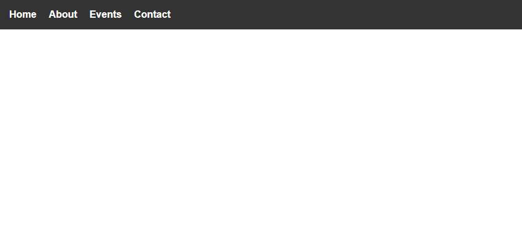
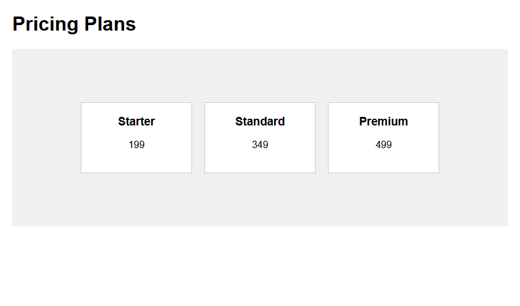
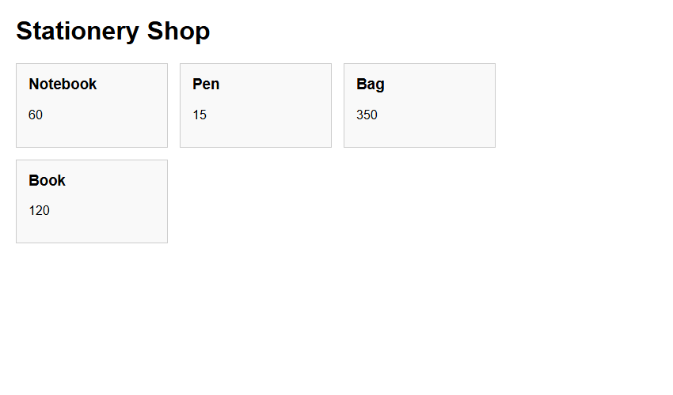

# Assignment 13: Flexbox Layouts

## 1. Experiment Title
Flexbox Layouts

## 2. Aim
Lay out a navigation bar, centred cards and cards that wrap, using Flexbox.

## 3. Software / Tools Required
- **Language / Technologies:** HTML5, CSS3, Git
- **Text Editor / IDE:** Visual Studio Code / Modern Web Editor
- **Web Browser:** Google Chrome / Mozilla Firefox / Modern Browser

## 4. Theory
CSS Flexible Box Layout module:
- `display: flex`: Activates flex formatting context.
- `justify-content`: Distributes items along main axis (`space-around`, `center`, `space-between`).
- `align-items`: Positions items along cross axis (`center`, `stretch`).
- `flex-wrap: wrap`: Allows flex items to break onto multiple lines on smaller viewports.

## 5. Tasks, Source Code & Output

### Question 1: Horizontal Flexbox Navigation Bar

**Problem Statement:**  
Create nav-flex.html with horizontal nav of 4 white links and dark background.

**Directory:** `Question1/`  

**Source File (`nav-flex.html`):**

```html
<!--
  Student Name: Shivam Gupta
  Roll Number: 2510303486
  Assignment: 13 - Task 01 (Flexbox Navigation)
-->
<!DOCTYPE html>
<html lang="en">
<head>
  <meta charset="UTF-8">
  <title>Flexbox Nav</title>
  <style>
    body {
      margin: 0;
      font-family: Arial, sans-serif;
    }
    nav {
      display: flex;
      background-color: #333333;
      padding: 15px;
      gap: 20px;
    }
    nav a {
      color: white;
      text-decoration: none;
      font-weight: bold;
    }
  </style>
  <link rel="stylesheet" href="style.css">
</head>
<body>
  <nav>
    <a href="#home">Home</a>
    <a href="#about">About</a>
    <a href="#events">Events</a>
    <a href="#contact">Contact</a>
  </nav>
</body>
</html>
```

**Source File (`style.css`):**

```css
/*
  Student Name: Shivam Gupta
  Roll Number: 2510303486
  Subject: HTML and CSS Introduction Lab (BCS352)
  University: Invertis University, Bareilly
*/
/* Flexbox Nav */
nav {
  display: flex;
  justify-content: space-around;
  background-color: #1e293b;
  padding: 14px 0;
  font-family: Arial, sans-serif;
}
nav a {
  color: #ffffff;
  text-decoration: none;
  font-weight: bold;
}
```

**Output Screenshot:**



---

### Question 2: Centered Cards with Justify-Content & Align-Items

**Problem Statement:**  
Create centred-cards.html with 3 cards centered horizontally and vertically in row.

**Directory:** `Question2/`  

**Source File (`centred-cards.html`):**

```html
<!--
  Student Name: Shivam Gupta
  Roll Number: 2510303486
  Assignment: 13 - Task 02 (Centred Flex Cards)
-->
<!DOCTYPE html>
<html lang="en">
<head>
  <meta charset="UTF-8">
  <title>Centred Cards</title>
  <style>
    body {
      font-family: Arial, sans-serif;
      margin: 20px;
    }
    .row {
      display: flex;
      justify-content: center;
      align-items: center;
      gap: 20px;
      min-height: 250px;
      background-color: #f0f0f0;
      padding: 20px;
    }
    .card {
      background-color: white;
      border: 1px solid #ccc;
      padding: 20px;
      width: 140px;
      text-align: center;
    }
    .card h3 {
      margin-top: 0;
    }
  </style>
  <link rel="stylesheet" href="style.css">
</head>
<body>
  <h1>Pricing Plans</h1>
  <div class="row">
    <div class="card">
      <h3>Starter</h3>
      <p>199</p>
    </div>
    <div class="card">
      <h3>Standard</h3>
      <p>349</p>
    </div>
    <div class="card">
      <h3>Premium</h3>
      <p>499</p>
    </div>
  </div>
</body>
</html>
```

**Source File (`style.css`):**

```css
/*
  Student Name: Shivam Gupta
  Roll Number: 2510303486
  Subject: HTML and CSS Introduction Lab (BCS352)
  University: Invertis University, Bareilly
*/
/* Centered Cards in Row */
body {
  font-family: Arial, sans-serif;
  margin: 0;
}
.row {
  display: flex;
  justify-content: center;
  align-items: center;
  min-height: 240px;
  gap: 20px;
  background-color: #f1f5f9;
  padding: 20px;
}
.card {
  background-color: #ffffff;
  border: 1px solid #cbd5e1;
  border-radius: 8px;
  padding: 16px;
  width: 140px;
  text-align: center;
  box-shadow: 0 2px 4px rgba(0, 0, 0, 0.05);
}
.card h3 {
  margin: 0 0 10px 0;
  color: #0f172a;
}
.card p {
  margin: 0;
  font-weight: bold;
  color: #2563eb;
}
```

**Output Screenshot:**



---

### Question 3: Flexbox Wrapping Cards (Desktop & Mobile)

**Problem Statement:**  
Create wrapping-cards.html with 4 stationery cards wrapping onto new rows on narrow screens.

**Directory:** `Question3/`  

**Source File (`style.css`):**

```css
/*
  Student Name: Shivam Gupta
  Roll Number: 2510303486
  Subject: HTML and CSS Introduction Lab (BCS352)
  University: Invertis University, Bareilly
*/
/* Wrapping Cards */
body {
  font-family: Arial, sans-serif;
  margin: 20px;
}
.flex-wrap-row {
  display: flex;
  flex-wrap: wrap;
  gap: 16px;
}
.card {
  background-color: #ffffff;
  border: 1px solid #cbd5e1;
  border-radius: 8px;
  padding: 16px;
  width: 150px;
  box-shadow: 0 2px 4px rgba(0, 0, 0, 0.05);
}
```

**Source File (`wrapping-cards.html`):**

```html
<!--
  Student Name: Shivam Gupta
  Roll Number: 2510303486
  Assignment: 13 - Task 03 (Wrapping Cards)
-->
<!DOCTYPE html>
<html lang="en">
<head>
  <meta charset="UTF-8">
  <title>Stationery Shop</title>
  <style>
    body {
      font-family: Arial, sans-serif;
      margin: 20px;
    }
    .cards {
      display: flex;
      flex-wrap: wrap;
      gap: 15px;
    }
    .card {
      background-color: #f9f9f9;
      border: 1px solid #ccc;
      padding: 15px;
      width: 160px;
    }
    .card h3 {
      margin-top: 0;
    }
  </style>
  <link rel="stylesheet" href="style.css">
</head>
<body>
  <h1>Stationery Shop</h1>
  <div class="cards">
    <div class="card">
      <h3>Notebook</h3>
      <p>60</p>
    </div>
    <div class="card">
      <h3>Pen</h3>
      <p>15</p>
    </div>
    <div class="card">
      <h3>Bag</h3>
      <p>350</p>
    </div>
    <div class="card">
      <h3>Book</h3>
      <p>120</p>
    </div>
  </div>
</body>
</html>
```

**Output Screenshot:**



---

## 6. Result
Result: All three tasks for Assignment 13 (Flexbox Layouts) were successfully implemented, executed, and verified according to university lab specifications.
