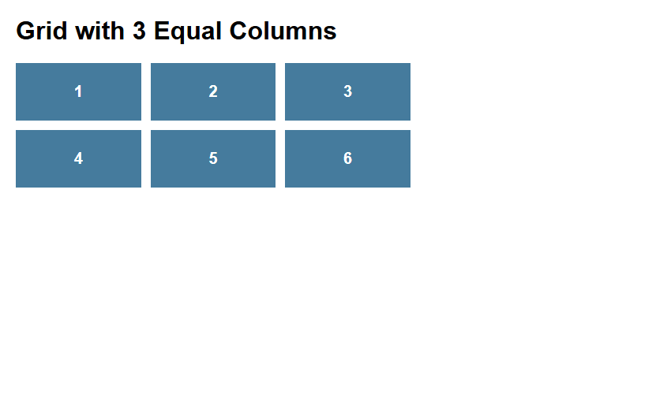
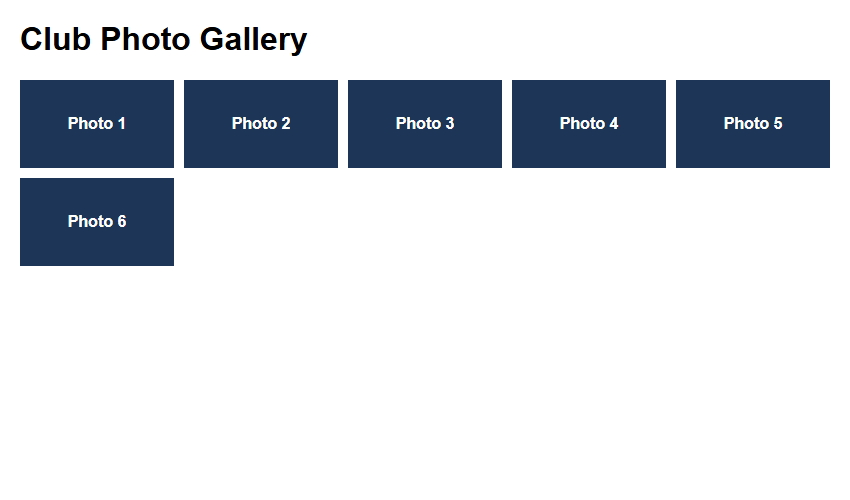
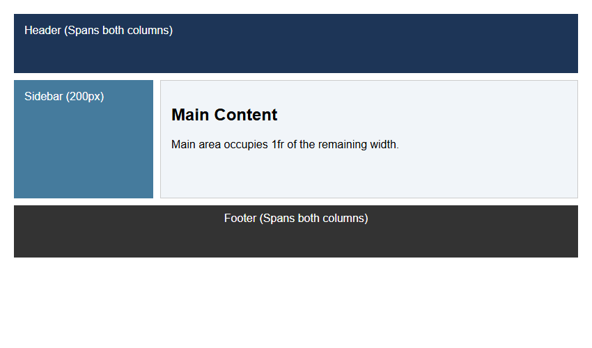

# Assignment 14: CSS Grid Layouts

## 1. Experiment Title
CSS Grid Layouts

## 2. Aim
Make a grid with equal columns, a responsive gallery and a layout with named areas.

## 3. Software / Tools Required
- **Language / Technologies:** HTML5, CSS3, Git
- **Text Editor / IDE:** Visual Studio Code / Modern Web Editor
- **Web Browser:** Google Chrome / Mozilla Firefox / Modern Browser

## 4. Theory
Two-dimensional CSS Grid Layout:
- `display: grid`: Establishes grid formatting context.
- Fractional unit (`fr`): Distributes remaining free grid space.
- `repeat(auto-fill, minmax(150px, 1fr))`: Creates fluid adaptive grid columns.
- `grid-template-areas`: Defines visual page layout templates with semantic area names.

## 5. Tasks, Source Code & Output

### Question 1: Three Equal Columns Grid with fr Units

**Problem Statement:**  
Create grid-first.html with 6 boxes in 3 equal columns (fr units) with 12px gap.

**Directory:** `Question1/`  

**Source File (`grid-first.html`):**

```html
<!--
  Student Name: Shivam Gupta
  Roll Number: 2510303486
  Assignment: 14 - Task 01 (CSS Grid 3-Columns)
-->
<!DOCTYPE html>
<html lang="en">
<head>
  <meta charset="UTF-8">
  <title>Grid First</title>
  <style>
    body {
      font-family: Arial, sans-serif;
      margin: 20px;
    }
    .grid {
      display: grid;
      grid-template-columns: 1fr 1fr 1fr;
      gap: 12px;
      max-width: 500px;
    }
    .box {
      background-color: #457b9d;
      color: white;
      padding: 25px;
      text-align: center;
      font-size: 20px;
      font-weight: bold;
    }
  </style>
  <link rel="stylesheet" href="style.css">
</head>
<body>
  <h1>Grid with 3 Equal Columns</h1>
  <div class="grid">
    <div class="box">1</div>
    <div class="box">2</div>
    <div class="box">3</div>
    <div class="box">4</div>
    <div class="box">5</div>
    <div class="box">6</div>
  </div>
</body>
</html>
```

**Source File (`style.css`):**

```css
/*
  Student Name: Shivam Gupta
  Roll Number: 2510303486
  Subject: HTML and CSS Introduction Lab (BCS352)
  University: Invertis University, Bareilly
*/
/* Three Column Equal Grid */
.grid-container {
  display: grid;
  grid-template-columns: repeat(3, 1fr);
  gap: 12px;
  font-family: Arial, sans-serif;
}
.box {
  background-color: #3b82f6;
  color: white;
  padding: 30px;
  text-align: center;
  font-size: 1.5rem;
  border-radius: 6px;
}
```

**Output Screenshot:**



---

### Question 2: Responsive Photo Gallery (auto-fill & minmax)

**Problem Statement:**  
Create gallery.html using repeat(auto-fill, minmax(150px, 1fr)) with 10px gap.

**Directory:** `Question2/`  

**Source File (`gallery.html`):**

```html
<!--
  Student Name: Shivam Gupta
  Roll Number: 2510303486
  Assignment: 14 - Task 02 (Responsive Photo Gallery)
-->
<!DOCTYPE html>
<html lang="en">
<head>
  <meta charset="UTF-8">
  <title>Club Photo Gallery</title>
  <style>
    body {
      font-family: Arial, sans-serif;
      margin: 20px;
    }
    .gallery {
      display: grid;
      grid-template-columns: repeat(auto-fill, minmax(150px, 1fr));
      gap: 10px;
    }
    .box {
      background-color: #1d3557;
      color: white;
      padding: 35px 10px;
      text-align: center;
      font-weight: bold;
    }
  </style>
  <link rel="stylesheet" href="style.css">
</head>
<body>
  <h1>Club Photo Gallery</h1>
  <div class="gallery">
    <div class="box">Photo 1</div>
    <div class="box">Photo 2</div>
    <div class="box">Photo 3</div>
    <div class="box">Photo 4</div>
    <div class="box">Photo 5</div>
    <div class="box">Photo 6</div>
  </div>
</body>
</html>
```

**Source File (`style.css`):**

```css
/*
  Student Name: Shivam Gupta
  Roll Number: 2510303486
  Subject: HTML and CSS Introduction Lab (BCS352)
  University: Invertis University, Bareilly
*/
/* Auto-fill Minmax Gallery Grid */
body {
  font-family: Arial, sans-serif;
  margin: 20px;
}
.gallery-grid {
  display: grid;
  grid-template-columns: repeat(auto-fill, minmax(150px, 1fr));
  gap: 10px;
}
.photo-box {
  background-color: #0f766e;
  color: white;
  padding: 40px 10px;
  text-align: center;
  border-radius: 6px;
}
```

**Output Screenshot:**



---

### Question 3: Dashboard Layout with Named Grid-Template-Areas

**Problem Statement:**  
Create dashboard-areas.html with grid-template-areas for header, sidebar, main, and footer.

**Directory:** `Question3/`  

**Source File (`dashboard-areas.html`):**

```html
<!--
  Student Name: Shivam Gupta
  Roll Number: 2510303486
  Assignment: 14 - Task 03 (Dashboard Grid Areas)
-->
<!DOCTYPE html>
<html lang="en">
<head>
  <meta charset="UTF-8">
  <title>Dashboard Areas</title>
  <style>
    body {
      font-family: Arial, sans-serif;
      margin: 20px;
    }
    .dashboard {
      display: grid;
      grid-template-columns: 200px 1fr;
      grid-template-areas:
        "header  header"
        "sidebar main"
        "footer  footer";
      gap: 10px;
      min-height: 350px;
    }
    header {
      grid-area: header;
      background-color: #1d3557;
      color: white;
      padding: 15px;
    }
    aside {
      grid-area: sidebar;
      background-color: #457b9d;
      color: white;
      padding: 15px;
    }
    main {
      grid-area: main;
      background-color: #f1f5f9;
      padding: 15px;
      border: 1px solid #ccc;
    }
    footer {
      grid-area: footer;
      background-color: #333333;
      color: white;
      padding: 10px;
      text-align: center;
    }
  </style>
  <link rel="stylesheet" href="style.css">
</head>
<body>
  <div class="dashboard">
    <header>Header (Spans both columns)</header>
    <aside>Sidebar (200px)</aside>
    <main>
      <h2>Main Content</h2>
      <p>Main area occupies 1fr of the remaining width.</p>
    </main>
    <footer>Footer (Spans both columns)</footer>
  </div>
</body>
</html>
```

**Source File (`style.css`):**

```css
/*
  Student Name: Shivam Gupta
  Roll Number: 2510303486
  Subject: HTML and CSS Introduction Lab (BCS352)
  University: Invertis University, Bareilly
*/
/* Dashboard Grid Areas */
body {
  font-family: Arial, sans-serif;
  margin: 0;
}
.dashboard {
  display: grid;
  grid-template-columns: 200px 1fr;
  grid-template-areas:
    "header  header"
    "sidebar main"
    "footer  footer";
  min-height: 320px;
}
header {
  grid-area: header;
  background-color: #1e293b;
  color: white;
  padding: 16px;
}
aside {
  grid-area: sidebar;
  background-color: #e2e8f0;
  padding: 16px;
}
main {
  grid-area: main;
  background-color: #ffffff;
  padding: 20px;
}
footer {
  grid-area: footer;
  background-color: #0f172a;
  color: white;
  padding: 12px;
  text-align: center;
}
```

**Output Screenshot:**



---

## 6. Result
Result: All three tasks for Assignment 14 (CSS Grid Layouts) were successfully implemented, executed, and verified according to university lab specifications.
