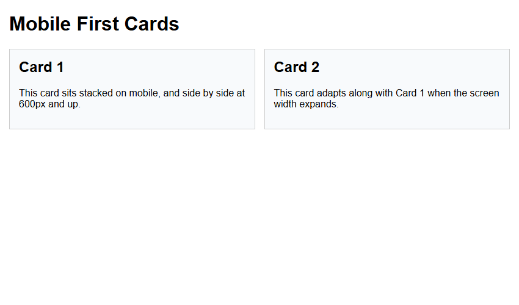
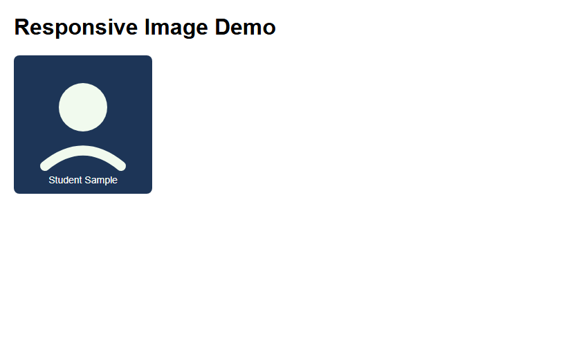
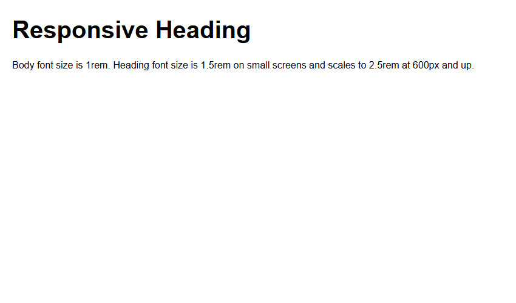

# Assignment 15: Responsive Pages with Media Queries

## 1. Experiment Title
Responsive Pages with Media Queries

## 2. Aim
Use a media query to change a layout, make a picture scale with its box, and set text sizes with rem units.

## 3. Software / Tools Required
- **Language / Technologies:** HTML5, CSS3, Git
- **Text Editor / IDE:** Visual Studio Code / Modern Web Editor
- **Web Browser:** Google Chrome / Mozilla Firefox / Modern Browser

## 4. Theory
Responsive Web Design (RWD) fundamentals:
- Viewport meta tag: Sets initial 1:1 mobile scaling.
- Mobile-First design: Default CSS styles mobile devices; `@media (min-width: 600px)` enhances desktop viewports.
- Fluid media: `max-width: 100%; height: auto;` scales images proportionally within containers.
- Responsive typography: Sizing base fonts with `rem` units scaled across media queries.

## 5. Tasks, Source Code & Output

### Question 1: Mobile-First Layout with 600px Breakpoint

**Problem Statement:**  
Create mobile-first.html starting as stacked cards, expanding to two cards per row at 600px.

**Directory:** `Question1/`  

**Source File (`mobile-first.html`):**

```html
<!--
  Student Name: Shivam Gupta
  Roll Number: 2510303486
  Assignment: 15 - Task 01 (Mobile First Cards)
-->
<!DOCTYPE html>
<html lang="en">
<head>
  <meta charset="UTF-8">
  <meta name="viewport" content="width=device-width, initial-scale=1.0">
  <title>Mobile First</title>
  <style>
    body {
      font-family: Arial, sans-serif;
      margin: 15px;
    }
    .cards {
      display: flex;
      flex-direction: column;
      gap: 15px;
    }
    .card {
      background-color: #f8fafc;
      border: 1px solid #ccc;
      padding: 15px;
    }
    .card h2 {
      margin-top: 0;
    }

    @media (min-width: 600px) {
      .cards {
        flex-direction: row;
      }
      .card {
        flex: 1;
      }
    }
  </style>
  <link rel="stylesheet" href="style.css">
</head>
<body>
  <h1>Mobile First Cards</h1>
  <div class="cards">
    <div class="card">
      <h2>Card 1</h2>
      <p>This card sits stacked on mobile, and side by side at 600px and up.</p>
    </div>
    <div class="card">
      <h2>Card 2</h2>
      <p>This card adapts along with Card 1 when the screen width expands.</p>
    </div>
  </div>
</body>
</html>
```

**Source File (`style.css`):**

```css
/*
  Student Name: Shivam Gupta
  Roll Number: 2510303486
  Subject: HTML and CSS Introduction Lab (BCS352)
  University: Invertis University, Bareilly
*/
/* Mobile First & Media Query */
body {
  font-family: Arial, sans-serif;
  margin: 16px;
  background-color: #f8fafc;
}
.cards {
  display: flex;
  flex-direction: column;
  gap: 16px;
}
.card {
  background-color: #ffffff;
  border: 1px solid #cbd5e1;
  border-radius: 8px;
  padding: 16px;
}
@media (min-width: 600px) {
  .cards {
    flex-direction: row;
  }
  .card {
    flex: 1;
  }
}
```

**Output Screenshot:**



---

### Question 2: Fluid Scaling Image with max-width: 100%

**Problem Statement:**  
Create responsive-image.html with max-width 100% and height auto scaling down to fit narrow screens.

**Directory:** `Question2/`  

**Source File (`responsive-image.html`):**

```html
<!--
  Student Name: Shivam Gupta
  Roll Number: 2510303486
  Assignment: 15 - Task 02 (Responsive Image)
-->
<!DOCTYPE html>
<html lang="en">
<head>
  <meta charset="UTF-8">
  <meta name="viewport" content="width=device-width, initial-scale=1.0">
  <title>Responsive Image</title>
  <style>
    body {
      font-family: Arial, sans-serif;
      margin: 20px;
    }
    img {
      max-width: 100%;
      height: auto;
    }
  </style>
  <link rel="stylesheet" href="style.css">
</head>
<body>
  <h1>Responsive Image Demo</h1>
  
</body>
</html>
```

**Source File (`style.css`):**

```css
/*
  Student Name: Shivam Gupta
  Roll Number: 2510303486
  Subject: HTML and CSS Introduction Lab (BCS352)
  University: Invertis University, Bareilly
*/
/* Responsive Fluid Image */
body {
  font-family: Arial, sans-serif;
  margin: 20px;
}
.img-container {
  max-width: 450px;
  border: 2px dashed #94a3b8;
  padding: 10px;
}
img {
  max-width: 100%;
  height: auto;
  display: block;
}
```

**Output Screenshot:**



---

### Question 3: Responsive Typography Scaling at Media Query

**Problem Statement:**  
Create responsive-text.html with 1rem body font and h1 scaling from 1.5rem to 2.5rem at 600px.

**Directory:** `Question3/`  

**Source File (`responsive-text.html`):**

```html
<!--
  Student Name: Shivam Gupta
  Roll Number: 2510303486
  Assignment: 15 - Task 03 (Responsive Text)
-->
<!DOCTYPE html>
<html lang="en">
<head>
  <meta charset="UTF-8">
  <meta name="viewport" content="width=device-width, initial-scale=1.0">
  <title>Responsive Text</title>
  <style>
    body {
      font-family: Arial, sans-serif;
      margin: 20px;
      font-size: 1rem;
    }
    h1 {
      font-size: 1.5rem;
    }

    @media (min-width: 600px) {
      h1 {
        font-size: 2.5rem;
      }
    }
  </style>
  <link rel="stylesheet" href="style.css">
</head>
<body>
  <h1>Responsive Heading</h1>
  <p>Body font size is 1rem. Heading font size is 1.5rem on small screens and scales to 2.5rem at 600px and up.</p>
</body>
</html>
```

**Source File (`style.css`):**

```css
/*
  Student Name: Shivam Gupta
  Roll Number: 2510303486
  Subject: HTML and CSS Introduction Lab (BCS352)
  University: Invertis University, Bareilly
*/
/* Responsive Typography */
body {
  font-family: Arial, sans-serif;
  font-size: 1rem;
  margin: 24px;
  color: #1e293b;
}
h1 {
  font-size: 1.5rem;
  color: #1d4ed8;
}
@media (min-width: 600px) {
  h1 {
    font-size: 2.5rem;
  }
}
```

**Output Screenshot:**



---

## 6. Result
Result: All three tasks for Assignment 15 (Responsive Pages with Media Queries) were successfully implemented, executed, and verified according to university lab specifications.
